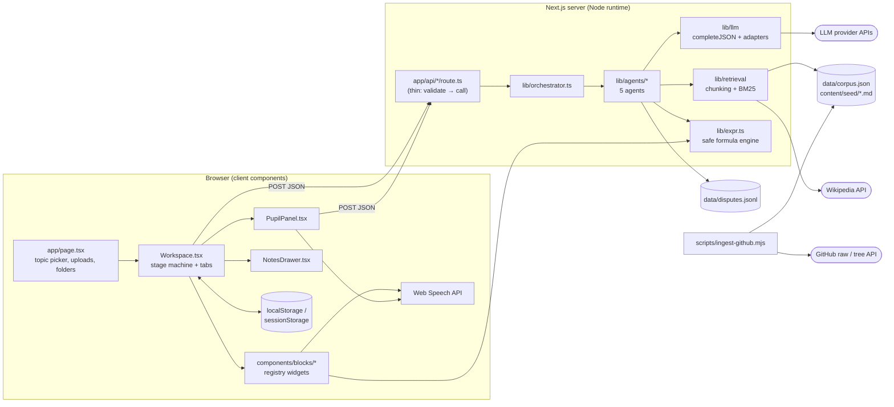
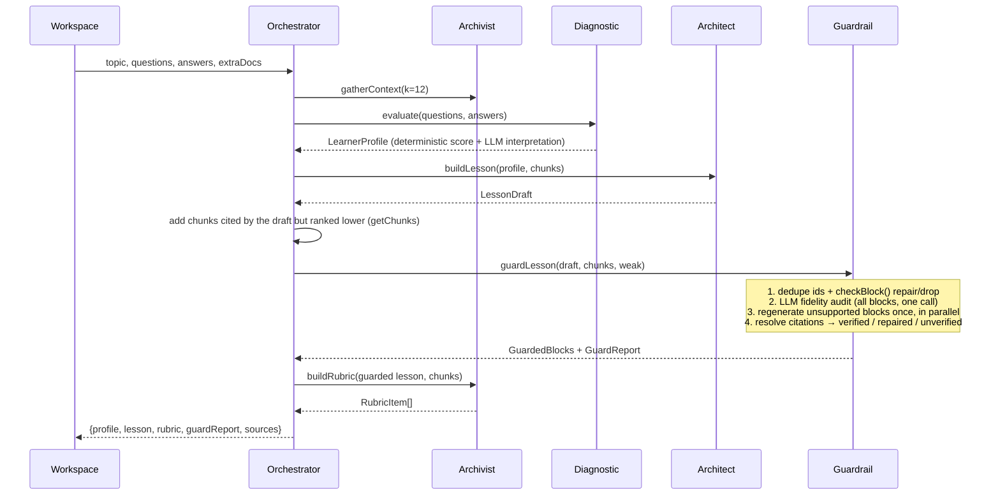

# Feynman Lab — Architecture

> Snapshot of the codebase as of 2026-11-01 (v0.1.0, hackathon MVP), including any-topic web grounding,
> learner lesson options, ✦ reimagine, dark mode, the voice fixes, the Next 16 / zod 4 upgrade, per-request time
> budgets and the Vercel deployment setup.
> For setup and usage, see `README.md`. This document explains **how the system is put together and why**.

---

## 1. What the system does

Feynman Lab is a single Next.js 16 app that runs a two-phase learning loop for any technical topic:

1. **Learn by doing.** A diagnostic calibrates the learner, who then picks the lesson's length, depth and amount of
   interactive content. An LLM "Teacher" generates an interactive lesson grounded in trusted repos and the web:
   sliders, step-through sequence diagrams, draggable architecture canvases, code traces and prediction questions.
   Any section (or the whole lesson) can then be **reimagined** from a free-text description.
2. **Prove it by teaching.** The learner explains the topic to an LLM "Pupil". The Pupil asks probing questions and
   checks the answers against a hidden rubric, which turns green (mastered) or red (gap) as the conversation goes.

Five cooperating **agents** do the work. They share a strict set of zod contracts and are sequenced by one
**orchestrator**. The LLM never emits HTML, JS or styling. It emits **typed JSON props** for a fixed registry of
React components (Server-Driven UI).

---

## 2. Tech stack

| Concern | Choice | Notes |
|---|---|---|
| Framework | Next.js 16 (App Router, Turbopack), React 19 | One deployable; pages + API route handlers. Node ≥ 20.9 |
| Language | TypeScript (strict) | Path alias `@/*` → project root |
| Validation | zod 4 | Every API request **and** every LLM response |
| Hosting | Vercel (Next.js preset, Fluid compute) | See README "Deploy on Vercel" |
| Diagrams | `@xyflow/react` (React Flow 12) | Only used by `DraggableArchitectureCanvas` |
| LLM access | Plain `fetch` adapters | No vendor SDKs. Anthropic, OpenAI, Gemini, OpenAI-compatible, mock |
| Retrieval | Hand-written BM25 + Wikipedia search | In-process, zero dependencies; web search is keyless and skipped offline |
| Persistence | `localStorage` / `sessionStorage` (client), JSONL file (server, disputes only) | No database, no auth |
| Voice | Browser Web Speech API | TTS + STT, client only |
| Styling | Single `app/globals.css` | 5 semantic colour tokens, redefined for dark mode; brutalist borders and shadows |

Runtime dependencies are only `next`, `react`, `react-dom`, `zod` and `@xyflow/react`.

---

## 3. High-level view



### Layering rules (enforced by convention)

```
app/api/*/route.ts   →  lib/http.ts (handler) + lib/api-schemas.ts
                     →  lib/orchestrator.ts        ← the ONLY module routes import
                     →  lib/agents/*.ts
                     →  lib/llm, lib/retrieval, lib/expr, lib/schemas, lib/fixtures
```

- Routes contain no logic. Each is about three lines: request schema → orchestrator function.
- Agents depend on `lib/llm`, `lib/retrieval` and `lib/schemas`. They may import each other's helpers
  (for example, `architect`, `diagnostic` and `guardrail` use `formatContext` / `GROUNDING_RULES` from `archivist`,
  and `guardrail` uses `regenerateBlock` and `keywordGrade`).
- `lib/schemas` and `lib/expr` are **isomorphic**. Both server and browser import them.
- `lib/client/*` is browser-only (`"use client"`).

---

## 4. Directory map

```
app/
  layout.tsx                 Root HTML, fonts, React Flow CSS
  page.tsx                   Home: topic input, suggested topics, .md/.txt uploads, topic folders, /api/status badge
  study/page.tsx             Reads ?topic= and mounts <Workspace key={topic}>
  globals.css                Design tokens + all component styles
  api/
    status/route.ts          GET  provider/model + corpus stats
    diagnostic/route.ts      POST start diagnostic           (maxDuration 60s)
    lesson/route.ts          POST build lesson + rubric      (maxDuration 300s)
    reimagine/route.ts       POST ✦ rewrite one block or the whole lesson (maxDuration 300s)
    pupil/route.ts           POST one teach-back turn        (maxDuration 60s)
    scorecard/route.ts       POST finish teach-back          (maxDuration 60s)
    notes/route.ts           POST extract a note from a block (maxDuration 30s)
    dispute/route.ts         POST learner flag / grading dispute (maxDuration 120s)

components/
  ThemeToggle.tsx            Auto → Light → Dark cycle button
  Sparkle.tsx                Gemini-style ✦ icon (the reimagine action)
  workspace/
    Workspace.tsx            Client "controller": stage machine, session, notes, disputes, reimagine + undo, tabs
    DiagnosticPanel.tsx      Multiple-choice + "why?" inputs, then "Shape what gets generated" (same screen)
    LessonOptionsPicker.tsx  Length / Depth / Interactive-content segmented controls
    ReimagineDialog.tsx      ✦ dialog: presets, free-text request, target widget type or new lesson options
    PupilPanel.tsx           Difficulty picker → chat + live rubric → scorecard
    NotesDrawer.tsx          Draft/edit/delete notes, export .md
  blocks/
    registry.tsx             type → React component map
    BlockFrame.tsx           Per-block chrome: ✦ + undo, verification badge, citations, narrate/flag/capture, error boundary
    types.ts                 BlockProps contract (onState, onCapture, narrate)
    ConceptBlock.tsx | InteractiveSliderBlock.tsx | FlowStepperDiagram.tsx
    DraggableArchitectureCanvas.tsx | ConceptCodeTracer.tsx | PredictionBlock.tsx

lib/
  orchestrator.ts            Sequences the agents per use case
  lesson-options.ts          Meaning of Length / Depth / Interactivity + shared diagnostic scoring (isomorphic)
  limits.ts                  Request size limits shared by api-schemas and the UI (isomorphic)
  theme-script.ts            Pre-paint theme script inlined in <head>
  schemas/index.ts           zod contracts for every artifact (the SDUI contract)
  api-schemas.ts             zod request bodies for routes
  http.ts                    Route wrapper: JSON parse → validate → run inside the route's time budget → error mapping
  llm/index.ts               Provider adapters, complete(), completeJSON() with self-repair, time budget (timeLeft)
  retrieval/index.ts         Heading-anchored chunking, BM25, corpus loading, per-request pool + cached merged index
  retrieval/web.ts           Wikipedia search → SourceDocs (cached per topic)
  expr.ts                    Sandboxed arithmetic/boolean expression parser + evaluator
  agents/
    archivist.ts             Agent 1: retrieval context, rubric, notes
    diagnostic.ts            Agent 2: questions, deterministic scoring, LearnerProfile
    architect.ts             Agent 3: lesson generation, block regeneration, REGISTRY_SPEC prompt
    pupil.ts                 Agent 4: teach-back turns, scorecard, mock keyword grader
    guardrail.ts             Agent 5: structural checks, citations, fidelity audit, pupil audit, disputes
  fixtures/tcp.ts            Offline TCP lesson, diagnostic, rubric, scripted pupil questions
  client/
    api.ts                   Typed POST wrapper
    store.ts                 localStorage folders/sessions, sessionStorage uploads, Markdown export
    speech.ts                TTS/STT with browser-quirk handling, speaker ownership (useSpeechOwner)
    theme.ts                 Theme choice, useResolvedTheme(), literal PALETTE for React Flow
    md.tsx                   Safe minimal Markdown → React (no innerHTML)

content/seed/                Curated seed notes (frontmatter: title, repo, url)
config/trusted-repos.json    Allow-list of GitHub repos/paths for ingestion
scripts/ingest-github.mjs    Pulls Markdown → data/corpus.json
data/                        Runtime data (corpus.json, disputes.jsonl, both gitignored)
```

---

## 5. Core contracts (`lib/schemas/index.ts`)

Everything that crosses an agent boundary or the network is a zod schema. These are the main artifacts:

| Artifact | Producer | Consumer | Purpose |
|---|---|---|---|
| `Chunk` (TS interface in retrieval) | Retrieval | All agents | A heading-anchored source section with `id`, `label`, `url`, `origin` |
| `DiagnosticQuestion[]` | Agent 2 | UI, Agent 2 | 3–4 MCQs tagged `mental-model` / `mechanism` / `implementation` |
| `LearnerProfile` | Agent 2 | Agent 3 | `level`, `depth`, `known`, `gaps`, `misconceptions`, `summary` |
| `LessonOptions` | Learner (UI) | Agent 3 | `length` short/standard/deep, `depth` auto/foundations/mechanisms/edge-cases, `interactivity` light/balanced/rich/max |
| `LessonDraft` | Agent 3 | Agent 5 | `title`, `summary`, `blocks: LessonBlock[]` (3–14) |
| `LessonBlock` | Agent 3 | Agent 5, UI | Discriminated union on `type`: `concept`, `slider`, `stepper`, `architecture`, `code`, `predict` |
| `GuardedBlock` | Agent 5 | UI | `LessonBlock` + `citations[]` + `verification{status: verified/repaired/unverified/model, issues}` |
| `Lesson` | Orchestrator | UI | `topic`, `title`, `summary`, `level`, `depth`, `options`, `grounding` (sources/assisted), `blocks` |
| `RubricItem[]` | Agent 1 | Agent 4, UI | Hidden ground truth: `expectation`, `keywords`, `tier`, `blockId` |
| `PupilTurn` | Agent 4 → Agent 5 | UI | `reply`, `targetId?`, `updates[{id, status, evidence}]` |
| `Scorecard` | Agent 4 | UI | `score`, `mastered[]`, `gaps[]` (each linked to a `blockId`), `nextSteps` |
| `FidelityReport` | Agent 5 (LLM) | Agent 5 | Per-block `supported` + issues |
| `DisputeVerdict` | Agent 5 | UI | `verdict`, `action`, optional `rubricPatch` / `regradeTo` |
| `NoteDraft` | Agent 1 | UI | `title`, `markdown` |
| `ExtraDoc` | Browser upload | Retrieval | `{name, text}` learner-supplied Markdown/text |

**Design invariant:** the block schemas contain **no colour, HTML or handler fields**. Visual state is expressed only as
`status: "ok" | "error" | "neutral"`, and the renderer maps it onto the palette. zod strips unknown keys, so anything
else the model emits is discarded.

`REGISTRY_SPEC` in `lib/agents/architect.ts` is the prose version of the `LessonBlock` union that the model sees.
It is kept in sync with `lib/schemas` **by hand** (see §12).

---

## 6. The agents

| # | Agent | File | LLM calls | Deterministic parts |
|---|---|---|---|---|
| 1 | Coursework & Repo Archivist | `archivist.ts` | rubric, note extraction | `gatherContext` (async: web + uploads pool, BM25, 25% relative cut-off, `weak` → `grounding`), `groundingRules()`, `deterministicNote` fallback, rubric `blockId` repair |
| 2 | Diagnostic Assessor | `diagnostic.ts` | question generation, misconception interpretation | Weighted scoring (1 / 1.25 / 1.5 by depth) → level thresholds 0.45 / 0.8 → depth |
| 3 | Sandbox Architect (Teacher) | `architect.ts` | lesson generation (prompt built from the options), block regeneration, ✦ `reimagineBlock` / `reimagineLesson` | Mock personalisation: the TCP fixture is re-ordered/trimmed by depth, interactivity and length |
| 4 | Socratic Protégé (Pupil) | `pupil.ts` | per-turn reply + rubric updates, scorecard narrative | Difficulty scoping (`inScope`), score = mastered / in-scope, mock keyword grader with misconception regexes |
| 5 | Compliance Manager (Guardrail) | `guardrail.ts` | fidelity audit, dispute verdict | `checkBlock` structural repair, citation resolution, pupil evidence-overlap audit, dispute logging |

Every agent has a **mock branch** (`isMock()`) that returns fixture-based or deterministic output, so the whole loop runs
offline for the TCP topic. Several LLM steps also **fall back to deterministic output** when they fail: profile
interpretation, note extraction, scorecard narrative and the fidelity audit (skipped).

---

## 7. Request flows

### 7.1 Diagnostic: `POST /api/diagnostic`

```
{topic, extraDocs}
  → Archivist.gatherContext(topic, uploads, k=10)       BM25 top-k, filter ≥ 25% of best score
  → Diagnostic.generateQuestions(topic, chunks)         LLM (or tcpDiagnostic)
  ← {questions, sources, weakSources, notice?}
```

`weakSources` is true when fewer than 2 chunks are found or the top BM25 score is below 4. The UI then warns that
blocks may be unverified. In mock mode, `notice` explains that only the TCP topic is available.

### 7.2 Lesson: `POST /api/lesson` (the heavy path)

The request carries the learner's `options` (defaults: standard / auto / balanced). `effectiveDepth` uses the
override or the diagnostic's inferred depth. The options set the block range, words per concept card, the
interactive/concept mix and `maxTokens` (6k / 9k / 14k), all defined in `lib/lesson-options.ts`.



With a real provider, a lesson costs **4 + N LLM calls**: profile, lesson, fidelity, rubric, plus one regeneration per
unsupported block. Each call can retry up to twice on validation failure. This is why the route has a 300 s
`maxDuration`, and why the work runs inside a **time budget** (§8): the fidelity audit only starts with ≥ 75 s left
and regeneration with ≥ 60 s, otherwise they are recorded in `guardReport.skippedForTime`. If every block fails the
structural checks the request fails with a clear 502. If the rubric call fails, `fallbackRubric()` derives one item
per block deterministically, so a finished lesson is never thrown away.

### 7.3 Teach-back: `POST /api/pupil` and `POST /api/scorecard`

```
{topic, difficulty, rubric, statuses, transcript}
  if no learner message yet → pupilOpening()           (no LLM)
  else Pupil.pupilTurn()                                LLM with hidden rubric in system prompt
     → Guardrail.auditPupilTurn()                       drop unknown ids; drop "mastered" unless
                                                        ≥ 50% of evidence tokens appear in the learner's words;
                                                        drop "gap" unless the item was just asked about, or the
                                                        quoted evidence comes from the latest learner message
  ← PupilTurn

scorecard: score computed deterministically; LLM only writes summary / gapWhy / nextSteps
```

The server is **stateless** here. The client sends the full rubric, current statuses and the most recent 80 transcript
messages on every turn (the server also trims anything longer instead of rejecting it), and the client merges the
returned `updates` into its statuses. Statuses carry the progress from older messages, so long teach-backs keep working.
The mock Pupil re-probes red items after the pending ones and only says "press Finish" once everything is mastered.

### 7.4 Reimagine (✦): `POST /api/reimagine`

```
scope = "block"  {instruction, block, preferType?, outline, profile, options}
  → gatherContext(topic, query = topic + block title + instruction)     web search keyed on topic → same chunk ids
  → Architect.reimagineBlock   keeps the block id; must become preferType if given; sees the lesson outline
  → Guardrail.guardSingle      structural checks, citations, fidelity (+ one regeneration)
  ← {block}  (client keeps the old version in session.revisions for ↶ Undo)

scope = "lesson" {instruction?, outline, profile, options}
  → Architect.reimagineLesson  lesson prompt for the (possibly new) options + the learner's request
  → guardLesson → buildRubric  (same finishLesson() as /api/lesson)
  ← {lesson, rubric, sources}  (client stores session.previous for undo; teach-back restarts)
```

Offline, block reimagine returns a notice and no change. Lesson reimagine applies the new options to the fixture.

### 7.5 Notes: `POST /api/notes`

The client strips `citations` / `verification` from the block and sends it with the live widget `state` snapshot and an
optional `focus` (a diagram node, step or trace line). Agent 1 returns a short Markdown note, falling back to a
deterministic extraction if the LLM fails. The note is saved client-side into the topic folder.

### 7.6 Disputes: `POST /api/dispute`

```
kind = "block"   (⚑ Flag issue, or a widget's error boundary "Report & regenerate")
kind = "grading" ("Unfair?" on a red rubric item)

  → gatherContext(k=10) + the block's own cited chunks
  → Guardrail.resolveDispute()      LLM verdict (mock: always regenerates blocks; keyword re-grade for grading)
  → normalizeVerdict()              rejected → no action; block flags never regrade; grading never regenerates
      regenerate_block   → Architect.regenerateBlock → guardLesson (single block)
      rubricPatch        → patched RubricItem
      regradeTo          → client overwrites that item's status (only when upheld)
  → append to data/disputes.jsonl (best effort; console log otherwise)
```

The client swaps the returned block or rubric item into its session, persists it and scrolls to the changed block.

---

## 8. LLM layer (`lib/llm/index.ts`)

- **Provider selection:** `LLM_PROVIDER` ∈ `mock | anthropic | openai | gemini | openai-compatible`. Unknown values fall back
  to `mock`. `LLM_MODEL` overrides the per-provider default.
- **Transport:** `postJSON` with an `AbortController` timeout. Non-2xx responses, timeouts and network failures all
  throw `LLMError` with a readable message, which `lib/http.ts` maps to **HTTP 502** (other errors → 500).
- **Time budget:** `handler(schema, fn, { maxDuration })` runs each request inside `withTimeBudget()` (an
  `AsyncLocalStorage` deadline = `maxDuration` − 8 s). The per-call timeout scales with `maxTokens`
  (`30 s + 20 ms/token`, clamped to 60–240 s, or `LLM_TIMEOUT_MS`) and is capped by `timeLeft()`. A call that can't
  start with at least 8 s left fails fast, and self-repair retries stop when less than 20 s remain.
- **OpenAI specifics:** `api.openai.com` gets `max_completion_tokens` (compatible servers keep `max_tokens`), and
  reasoning models (`o*`, `gpt-5*`) are sent no temperature.
- **`completeJSON(req, schema, retries=2)`** is the backbone of output safety:
  1. Call the provider, asking for JSON mode where the provider supports it (OpenAI `response_format`, Gemini `responseMimeType`).
  2. `extractJSON` pulls the first `{…}` object out of the reply, tolerating code fences and preambles.
  3. `schema.safeParse`. On failure, the zod issues are appended as a user message and the model is asked to fix
     its own output (self-repair loop).
  4. After `retries + 1` failed attempts, throw `LLMError`.
- Calling `complete()` in mock mode throws. Agents must short-circuit with `isMock()` first.
- Adding a provider means one `callX()` function plus one `switch` case (~30 lines).

Temperatures are tuned per task: 0 for the fidelity audit, 0.1–0.3 for grading and rubric work, 0.4 for lesson
generation, 0.6 for the Pupil persona.

---

## 9. Retrieval and grounding (`lib/retrieval/index.ts`)

### Sources (merged into one index)

| Origin | Where from | Lifetime |
|---|---|---|
| `github` | `data/corpus.json`, written by `npm run ingest` from `config/trusted-repos.json` | Loaded once per server process |
| `seed` | `content/seed/*.md` (frontmatter `title`, `repo`, `url`) | Loaded once per server process |
| `web` | Wikipedia search on the topic (`lib/retrieval/web.ts`), top 3 pages, reference sections dropped | Cached per topic for 6 h (failures aren't cached) |
| `upload` | `ExtraDoc[]` in the request body (from `sessionStorage`); ids derive from the file name | Per request |

### Chunking

- Seed frontmatter is parsed after normalising CRLF line endings (Windows checkouts with `core.autocrlf`).
- Split on Markdown headings `#`–`####`, ignoring headings inside ```` ``` ```` / `~~~` code fences.
- Chunk id = `<docId>#<github-slug>` (`~n` suffix when a section is split at about 1600 chars on paragraph boundaries).
- Chunk URL = the GitHub blob URL plus the heading anchor. A `<!-- source: URL -->` comment inside a section overrides
  it (the seed notes use this to cite RFC sections).
- Sections whose body is under 40 characters are skipped.

### Ranking

BM25 with k1 = 1.4 and b = 0.75. Headings are counted twice to boost them, and there is a small stop-word list.
Tokens are Unicode letters/digits, so non-English Wikipedia editions rank properly.
The base index is **cached in module scope**. Web + upload chunks form a per-request *pool*. The merged index over
base + pool is cached by the pool's signature (LRU of 16), so repeated calls for the same topic don't rebuild it.

### Ingestion (`scripts/ingest-github.mjs`)

- Exact `.md` / `.mdx` paths are fetched from `raw.githubusercontent.com` (no API quota). The script tries the configured
  branch, else `main` and then `master`.
- Directory prefixes use the GitHub repo and tree APIs (`GITHUB_TOKEN` recommended).
- A filter argument (`npm run ingest -- docker`) re-ingests only the matching repos and keeps the other documents.
- Never fails the process: a repo that errors or yields no files keeps its previously ingested documents. Fetches time
  out after 20 s, line endings are normalised, and titles come from frontmatter `title:` (any line) or the first `#`.
- Output is raw documents only. Chunking happens at server start, so the server must be **restarted after ingesting**.
- On Vercel, `npm run build:vercel` runs ingest before `next build`, since `data/corpus.json` is gitignored.

### How grounding is enforced

1. Agents receive sources as `[chunk-id] (label)\ntext` blocks plus `GROUNDING_RULES`.
2. The model cites **chunk ids only**. Agent 5 resolves them to `{label, url}` and drops unknown ids, so URLs can't be invented.
3. A block with zero resolvable citations is marked `unverified`.
4. The LLM fidelity audit flags claims that contradict the sources or don't appear in them. Flagged blocks get one
   regeneration attempt, and if that fails they are marked `unverified`.
5. **Assisted mode.** When retrieval is weak (fewer than 2 chunks, or a top score under 4), `grounding = "assisted"`.
   Prompts then allow well-established general knowledge, but only in blocks with **empty** `sourceIds`. Such
   blocks get `verification.status = "model"` (shown as ◇ model knowledge), and only cited blocks are
   fidelity-audited.

---

## 10. Safety model for generated UI

| Threat | Mitigation | Where |
|---|---|---|
| Model emits HTML/JS/styles | No such fields in the schemas; zod strips unknown keys; UI renders only registry components | `lib/schemas`, `registry.tsx` |
| Slider formulas executing code | Formulas are parsed by a whitelisted grammar (numbers, identifiers, operators, 13 math functions, `pi`, `e`), max 300 chars; never `eval` | `lib/expr.ts` |
| Formulas that crash or return NaN/∞ | `checkExpr` at default values; bad outputs dropped, bad `goodWhen` / `badWhen` removed | `guardrail.checkBlock` |
| Broken widget structure | Edges to missing nodes, unknown lanes, out-of-range indexes, trace lines past EOF, duplicate params/nodes, min ≥ max, pre-drawn challenge edges, overlapping nodes → repaired or block dropped | `guardrail.checkBlock` |
| One widget crashing the page | Per-block React error boundary with "Report & regenerate" | `BlockFrame.tsx` |
| Markdown injection | Custom Markdown renderer builds React nodes; links limited to `https?:`; no `dangerouslySetInnerHTML` | `lib/client/md.tsx` |
| Pupil awarding unearned credit | "Mastered" needs ≥ 50% token overlap between the quoted evidence and the learner's actual words | `guardrail.auditPupilTurn` |
| Malformed requests | Every route validates its body with zod; bounded array and string sizes | `lib/api-schemas.ts`, `lib/http.ts` |

The `verification.status` shown on each block is `verified` (citations resolved, checks clean), `repaired`
(auto-fixed or citations pruned) or `unverified` (no source, or a failed fidelity audit).

---

## 11. Client architecture

### Workspace state machine (`components/workspace/Workspace.tsx`)

```
            ┌──────────── saved session in localStorage? ────────────┐
mount ──────┤ no                                                     │ yes
            ▼                                                        ▼
       loading ──/api/diagnostic──▶ diagnostic ──/api/lesson──▶ ready ◀──┘
          │                              │                        │
          └──────────── error ◀──────────┘                        ├── tab "learn": BlockFrame × N
                                                                  └── tab "teach": PupilPanel
                                                                         picker → chat → scorecard
```

- `Workspace` owns `session`, `folder`, `draft` (pending note), `dispute` target, toasts and the "flash and scroll to
  block" navigation used by notes, scorecard gaps and dispute results.
- `/study?topic=…` mounts `<Workspace key={topic}>`, so changing the topic resets all state.
- Async results (notes, disputes, several concurrent block reimagines) apply to the latest session through a ref
  (`update(fn)`), so they can't overwrite each other.
- Block widgets are keyed by a hash of their content, so a reimagined or undone block remounts with fresh local state.

### Block widget contract (`components/blocks/types.ts`)

```ts
interface BlockProps<T> {
  block: T;                                     // a GuardedBlock of one type
  onState(state: Record<string, unknown>);     // live widget state → snapshot for notes
  onCapture(focus?: { title; detail });        // capture the whole block or one sub-element
  narrate(text, onEnd?);                       // TTS
}
```

`BlockFrame` wraps each widget with a header (index, type label, verification badge), the error boundary and a footer
(citations, Narrate, Flag, Capture). It keeps the latest `onState` value in a ref, so notes capture what the learner
was actually looking at, such as the slider values or the current stepper step.

| Widget | Interactive state reported |
|---|---|
| `ConceptBlock` | none |
| `InteractiveSliderBlock` | param values + computed outputs (evaluated client-side via `lib/expr`) |
| `FlowStepperDiagram` | scenario, step index/label, per-step state vars. Supports play/pause and narrate-while-playing |
| `DraggableArchitectureCanvas` | selection, challenge progress. React Flow nodes/edges, learner draws required edges |
| `ConceptCodeTracer` | step, line, variables |
| `PredictionBlock` | picked option, correctness |

### Persistence (`lib/client/store.ts`)

All keys are prefixed `feynman-lab:`.

| Key | Storage | Content |
|---|---|---|
| `folders` | localStorage | List of folder slugs |
| `folder:<slug>` | localStorage | `{topic, notes[], scores[], updatedAt}`. Notes can carry widget snapshots |
| `session:<slug>` | localStorage | `{profile, lesson, rubric, sources, guardReport, teach?{difficulty, transcript, statuses, scorecard?}}` |
| `uploads` | sessionStorage | `ExtraDoc[]` (≤ 10 files, ≤ 200k chars each; same name replaces) sent with every request |

Every storage access is wrapped in try/catch, so private windows and full storage degrade to in-memory behaviour.
"Export .md" serialises a folder (scores + notes + snapshots) into a study sheet.

### Voice (`lib/client/speech.ts`)

TTS is used for block narration (Narrate ⇄ Stop), stepper autoplay narration and the Pupil's voice (second-best voice,
higher pitch). STT provides continuous dictation into the teach-back composer (Chrome, Edge and Safari; Firefox has
TTS only). The module handles these browser quirks:

- **Generations.** Every `speak()` starts a new generation, and callbacks from cancelled utterances are ignored. This
  fixed the stepper skipping steps when narration was interrupted.
- **Speaker ownership.** `useSpeechOwner()` tells widgets who is talking: a narrating stepper pauses if another block
  starts speaking, and widgets can't silence each other.
- **Chunked speech.** Text is spoken in chunks of 220 characters or fewer to avoid Chrome's ~15 s cutoff. There's a
  90 ms delay after `cancel()` because Chrome drops immediate `speak()` calls. The live utterance is pinned against
  garbage collection, and a watchdog moves on if the engine stalls.
- **Dictation.** It auto-restarts after silence. `stop()` keeps the last words and `abort()` (used on Send) discards
  late results. The user sees friendly messages for permission, missing-microphone, network and non-HTTPS errors.

### Design system and theming (`app/globals.css`)

There are exactly five semantic colours: white surface, black ink/borders, **blue = interactive / pending**,
**green = valid / mastered**, **red = error / gap**. Tints are derived with `color-mix`. The look is square corners,
2 px borders and hard offset shadows, with Space Grotesk and JetBrains Mono as the fonts.

**Dark mode** redefines the same tokens (`--white` becomes the dark surface and `--black` becomes light ink) plus a
few derived ones: `--page`, `--edge` (softer borders), `--shadow-ink`, `--on-accent` (dark text on lighter accents)
and `--scrim`. Components therefore never branch on theme.

- **Which theme applies.** `html[data-theme]` forces light or dark; when it's absent, `prefers-color-scheme` decides.
- **No flash.** `lib/theme-script.ts` applies the saved choice before first paint.
- **React Flow.** Its edge markers need literal colours, so the canvas reads `PALETTE` from `lib/client/theme.ts`,
  re-colours its edges on theme change and passes `colorMode`.
- **Palette exception.** The ✦ sparkle's blue → violet → rose gradient is the one deliberate exception to the palette.

---

## 12. Offline / mock mode

`LLM_PROVIDER=mock` (the default) turns every agent into a deterministic script built on `lib/fixtures/tcp.ts`:

- **Diagnostic** returns fixed TCP questions, and scoring stays fully real.
- **Lesson**: the fixture lesson is re-ordered or trimmed by learner level (advanced skips the basics and moves edge
  cases forward; intermediate drops the analogy).
- **Rubric**: fixed items. Each fixture item also carries misconception regexes that the mock Pupil uses to mark gaps.
- **Pupil**: a keyword grader (1 hit needed for easy items, 2 for others), scripted questions per item and
  difficulty, and a "you didn't answer my question" rule that marks a gap.
- **Fidelity audit**: skipped. Structural checks and citation resolution still run against the seed corpus.
- **Disputes**: blocks are always regenerated (returns the fixture block); grading disputes are re-graded by keyword.
- `lesson.topic` is forced to `"TCP 3-Way Handshake"`. Any other topic shows a notice.

The fixture doubles as the **reference example of good agent output**, and it is validated against the real schemas at
import time (`LessonDraft.parse`, `RubricItem.parse`).

---

## 13. Configuration

| Variable | Used by | Purpose |
|---|---|---|
| `LLM_PROVIDER` | `lib/llm` | `mock` (default) / `anthropic` / `openai` / `gemini` / `openai-compatible` |
| `LLM_MODEL` | `lib/llm` | Overrides the default model per provider |
| `ANTHROPIC_API_KEY`, `OPENAI_API_KEY`, `GEMINI_API_KEY` | `lib/llm` | Provider credentials (server-side only) |
| `OPENAI_COMPATIBLE_BASE_URL`, `OPENAI_COMPATIBLE_API_KEY` | `lib/llm` | Ollama, Groq, Together, vLLM, LM Studio… |
| `WEB_SEARCH` | `lib/retrieval/web.ts` | `on` (default) / `off`. Wikipedia grounding; always off in mock mode |
| `WEB_SEARCH_LANG` | `lib/retrieval/web.ts` | Wikipedia edition (default `en`) |
| `LLM_TIMEOUT_MS` | `lib/llm` | Fixed per-call timeout (default scales with output size, capped by the time budget) |
| `GITHUB_TOKEN` | ingest script | Higher GitHub API limits for directory prefixes |

`next.config.mjs` adds `content/**` and `data/**` to `outputFileTracingIncludes` for `/api/**`, so the corpus ships with
serverless and standalone builds (verified in the `.nft.json` traces of the API routes).

**Vercel:** Next.js preset, Build Command `npm run build:vercel`, default install/output/dev settings, Fluid compute on
(required for the 300 s routes). Full table in README "Deploy on Vercel".

---

## 14. Known limitations and architectural risks

These come from reading the current code. They are not bugs in the MVP's intended scope, but they matter for anyone
taking it further.

1. **The "hidden" rubric is client-visible and client-authoritative.** The rubric and the per-item statuses are returned
   to the browser, stored in `localStorage` and sent back on every Pupil turn. A learner can read the expectations in
   devtools, or forge statuses or rubric items before scoring. Fixing this needs a server-side session store keyed by
   session id.
2. **No auth, rate limiting or cost controls.** Any caller can trigger multi-call lesson generation on the configured
   API key.
3. **Manual contract sync.** `REGISTRY_SPEC` (prompt), `lib/schemas` (zod, including `BLOCK_TYPES`), `checkBlock`
   (repairs), `blockClaims` (fidelity), `deterministicNote`, `registry.tsx` and the type labels in `ReimagineDialog`
   must all change together when a widget is added or modified. Nothing checks this at compile time except the
   `switch` exhaustiveness in a few places. `PALETTE` in `lib/client/theme.ts` must also mirror the CSS tokens.
4. **Corpus and web cache are process-local.** Ingesting requires a restart. On serverless, each cold instance
   re-runs the Wikipedia search. Results are usually identical, but a changed article could shift chunk ids between
   the lesson and a later dispute or reimagine.
5. **Web grounding is Wikipedia only.** It's good for concepts but thin on very new tools or vendor specifics. Those
   lessons fall back to labelled model knowledge. A general web-search API could plug into `webDocs()`.
6. **Lesson latency.** The 4 + N sequential and parallel LLM calls, each with up to two repair retries, can approach
   the 300 s route limit on slow models, especially "Deep dive" (14k output tokens). The time budget degrades
   gracefully (skips the fidelity audit and regeneration first), but a single lesson call slower than the budget
   still fails. Streaming the lesson call would remove that limit.
   Option compliance (block count, interactive share) is asked for in the prompt but not enforced by the guardrail.
7. **Dispute log is best-effort.** On read-only filesystems (serverless) it silently falls back to console output.
8. **Lexical grading.** Both the Pupil audit (token overlap) and the mock grader (keywords) are lexical, so paraphrases
   can be under-credited. The dispute flow is the safety valve.
9. **No tests or CI in the repo.** `npm run typecheck` (also run by `next build`) is the only automated check that
   ships with it.

---

## 15. Extension points

| To… | Change |
|---|---|
| Add an LLM provider | `lib/llm/index.ts`: add the name to `ProviderName` and `DEFAULT_MODELS`, a `callX()` and a `switch` case |
| Add a widget type | zod schema in the `LessonBlock` union → `REGISTRY_SPEC` → `checkBlock()` → `blockClaims()` → `deterministicNote()` → component in `components/blocks/` → `registry.tsx` |
| Swap BM25 for embeddings | Replace `retrieve()` / `BM25` in `lib/retrieval`. Keep the `Chunk` shape and ids so citations keep working |
| Add a web source (Brave, Tavily, docs sites) | Return more `SourceDoc`s from `webDocs()` in `lib/retrieval/web.ts`, with stable `docId`s and an `anchorStyle` |
| Change what an option means | `lib/lesson-options.ts`. The UI labels, prompt rules and mock trimming all read from it |
| Add trusted sources | Edit `config/trusted-repos.json` → `npm run ingest` → restart |
| Add offline topics | Add a fixture alongside `lib/fixtures/tcp.ts` and route the mock branches by topic |
| Add accounts / multi-device | Replace `lib/client/store.ts` with API-backed storage, and move rubric and status ownership server-side (see §14.1) |
| Support PDF uploads | Parse in the home page uploader (for example with `pdfjs-dist`) into `ExtraDoc.text` |
